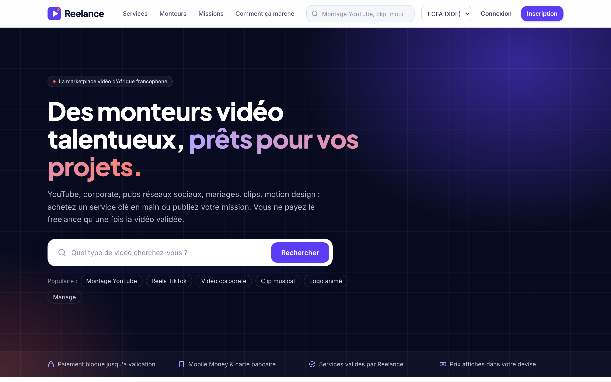
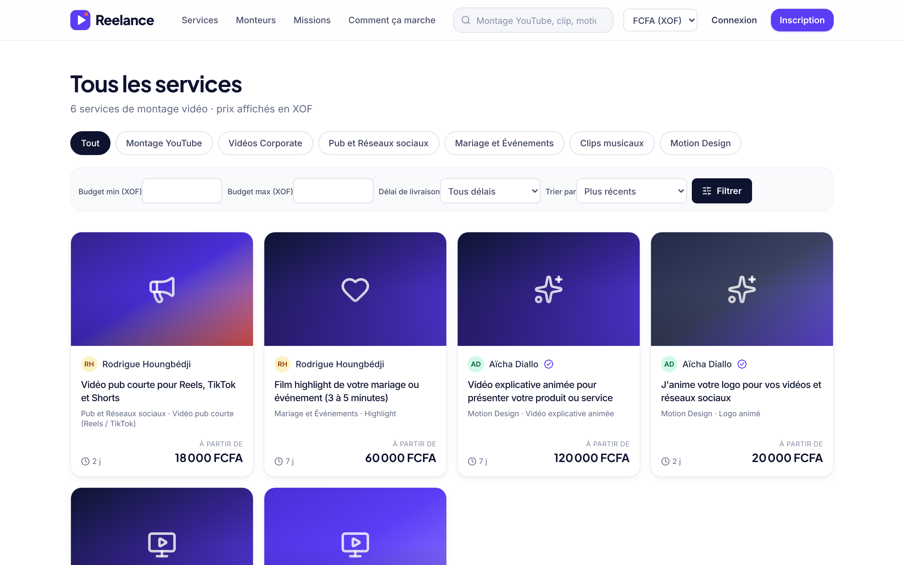
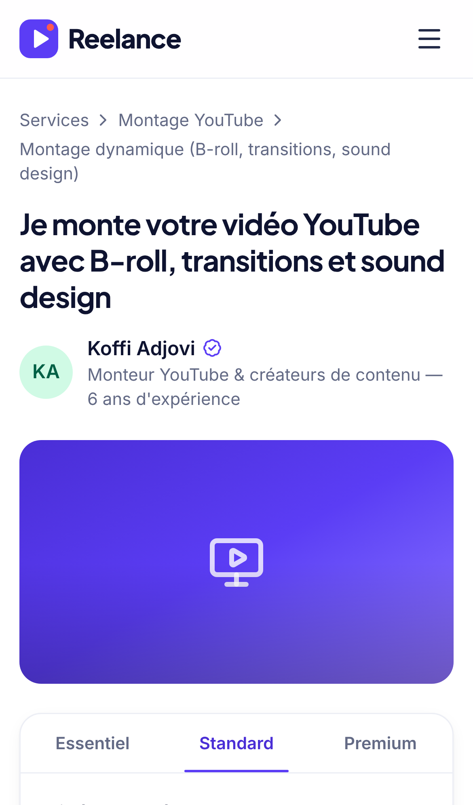
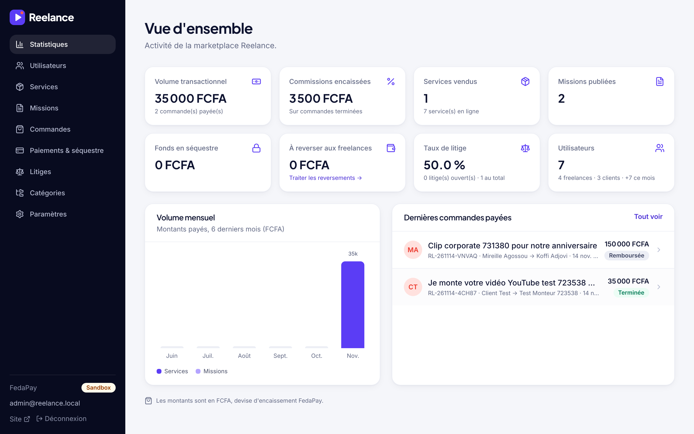
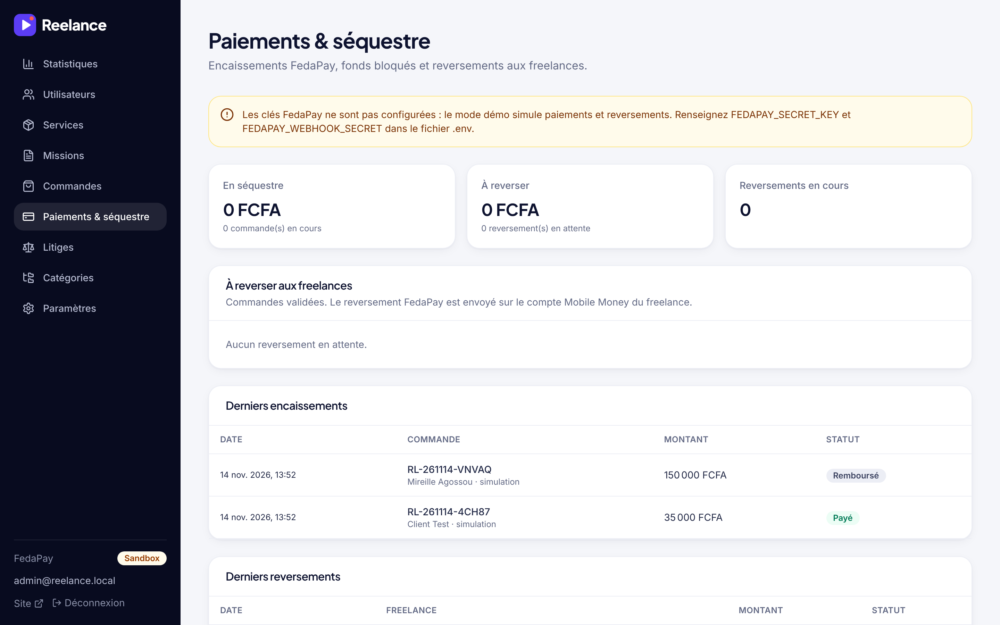

# Reelance

Marketplace qui met en relation des **monteurs vidéo freelances** et des **entreprises** en Afrique francophone (marché principal : Bénin).

Deux façons de travailler, un seul moteur de paiement :

- **Services (gigs)** à prix fixe, en 1 à 3 offres (Essentiel, Standard, Premium), achetables directement, comme sur Fiverr.
- **Missions** publiées par les clients, avec candidatures (message + devis) des freelances, comme sur Upwork.

Dans les deux cas, le client paie via **FedaPay**, les fonds restent **en séquestre** sur la plateforme, puis sont reversés au freelance (Mobile Money) après validation de la livraison.

| Accueil | Catalogue des services |
| --- | --- |
|  |  |
| **Fiche service (mobile)** | **Profil monteur (mobile)** |
|  |  |
| **Back office : statistiques** | **Back office : paiements et séquestre** |
|  |  |

## Fonctionnalités de la V1

| Rôle | Ce qu'il peut faire |
| --- | --- |
| **Visiteur** | Parcourir les services (filtres catégorie, budget, délai, tri), les profils de monteurs, les missions ouvertes ; choisir sa devise d'affichage |
| **Freelance** | S'inscrire seul ; profil (photo, présentation, compétences, logiciels, tarif) ; portfolio vidéo (YouTube, Vimeo, Drive) ; compte Mobile Money de reversement ; publier des services à 3 niveaux de prix ; postuler aux missions ; livrer ; suivre ses gains (séquestre, à recevoir, reçu) |
| **Client (entreprise)** | S'inscrire seul ; acheter un service ; publier une mission et retenir un freelance ; payer (Mobile Money, carte) ; valider une livraison, demander une retouche ou ouvrir un litige |
| **Admin (DIMO)** | Statistiques (volume, commissions, services vendus, missions, séquestre, taux de litige) ; utilisateurs (suspension, badge « vérifié ») ; validation des services et missions ; commandes ; reversements FedaPay ; litiges ; catégories ; paramètres (commission, délai de validation automatique, modération) |

Règles de gestion retenues :

- **Commission** : retenue sur le montant reversé au freelance (10 % par défaut, modifiable dans le back office). Le client paie le prix affiché, sans frais.
- **Reversement** : l'admin déclenche le décaissement FedaPay vers le Mobile Money du freelance (ou enregistre un paiement manuel).
- **Validation automatique** : sans réponse du client 3 jours (réglable) après une livraison, la commande est validée.
- **Médias** : vidéos en liens (YouTube, Vimeo, Drive, WeTransfer) ; images (photo, couverture, logo) sur Cloudinary.
- **Devises** : le freelance saisit un prix en FCFA. Il est converti à l'affichage (EUR, USD, CAD, GBP, CHF, XAF). FedaPay débite en FCFA ; la commande et le séquestre gardent les deux montants et le taux utilisé.

Hors V1 : messagerie, avis et notes, contrats en ligne.

## Stack

- **Next.js 16** (App Router, Server Actions) + **TypeScript** + **Tailwind CSS 4**
- **PostgreSQL** + **Prisma 7** (adaptateur `pg`, sans binaire natif)
- Authentification maison : e-mail et mot de passe (bcrypt), sessions en base, rôles `ADMIN`, `FREELANCER`, `CLIENT`
- **FedaPay** : API REST appelée directement (mêmes endpoints que le SDK officiel), webhook signé
- Cloudinary (images), SMTP (e-mails), open.er-api.com (taux de change, sans clé)

## Démarrage en local

Prérequis : Node.js 20.9 ou plus, PostgreSQL 14 ou plus.

```bash
cd reelance
npm install
cp .env.example .env          # puis renseignez DATABASE_URL, ADMIN_EMAIL, ADMIN_PASSWORD
npm run db:deploy             # crée les tables
npm run db:seed               # catégories + compte admin
SEED_DEMO=true npm run db:seed   # (optionnel) monteurs, services, client et mission de démo
npm run dev                   # http://localhost:3000
```

Pour tester tout le parcours sans clés FedaPay, mettez `PAYMENT_SIMULATION=true` dans `.env` : le bouton « Payer » ouvre une page de paiement simulé, et les reversements sont simulés. Ce mode est ignoré si `FEDAPAY_ENV=live`.

Comptes de démo (avec `SEED_DEMO=true`), mot de passe `Demo-Reelance-2026` :

| Compte | E-mail |
| --- | --- |
| Freelance (Cotonou) | `koffi.demo@reelance.local` |
| Freelance (Abidjan) | `aicha.demo@reelance.local` |
| Freelance (Porto-Novo) | `rodrigue.demo@reelance.local` |
| Client (Bénin, FCFA) | `client.demo@reelance.local` |
| Client (France, EUR) | `client.paris@reelance.local` |

## Scripts

| Commande | Rôle |
| --- | --- |
| `npm run dev` | Serveur de développement |
| `npm run build` | Génère le client Prisma puis le build de production |
| `npm start` | Lance le build de production |
| `npm run typecheck` | Vérification TypeScript |
| `npm run db:migrate` | Crée une nouvelle migration après modification du schéma (développement) |
| `npm run db:deploy` | Applique les migrations (production) |
| `npm run db:seed` | Catégories + compte admin (idempotent) |
| `npm run db:studio` | Explorateur de base de données Prisma |

## Documentation

- [Architecture, modèle de données et flux de paiement](docs/architecture.md)
- [Intégration FedaPay : clés, webhook, reversements, passage en production](docs/fedapay.md)
- [Déploiement : Vercel, VPS Hostinger (PM2 ou Docker)](docs/deploiement.md)
- [Charte graphique et intégration du logo](docs/charte-graphique.md)
- Variables d'environnement : [`.env.example`](.env.example), commentée ligne par ligne
