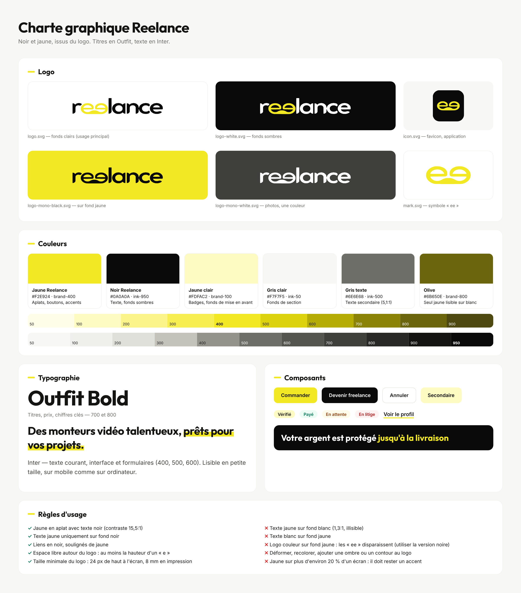

# Charte graphique

L'identité part du logo : un mot « reelance » en lettres noires géométriques et arrondies, et un **« ee » jaune** dont le second « e » est inversé et relié au premier. Le site reprend ce duo **noir + jaune** sur une base blanche et des gris neutres légèrement chauds, pour un rendu net et crédible de grande marketplace.

## Logo

Fichiers dans `public/brand/` (voir le [README du dossier](../public/brand/README.md)) :

| Fichier | Usage |
| --- | --- |
| `logo.svg` | Version principale, lettres noires, sur fond clair |
| `logo-white.svg` | Lettres blanches, sur fond noir ou sombre (pied de page, back office, visuels) |
| `logo-mono-black.svg` / `logo-mono-white.svg` | Une seule couleur : sur fond jaune, sur photo, impression une couleur |
| `icon.svg` | « ee » jaune sur carré noir : favicon, icône d'application, avatar des réseaux sociaux |
| `mark.svg` | « ee » seul, sans fond, pour les éléments décoratifs (bannière des profils) |
| `logo-email.png` | Version PNG pour les e-mails |

Le site utilise aussi `src/app/icon.svg` (favicon), `src/app/apple-icon.png` (écran d'accueil iPhone) et `src/app/opengraph-image.png` (aperçu des liens partagés sur WhatsApp, Facebook, LinkedIn).

Règles :

- Espace libre autour du logo : au moins la hauteur d'un « e ».
- Taille minimale : 24 px de haut à l'écran, 8 mm en impression.
- Sur fond jaune, utiliser la version tout noir (sinon les « ee » disparaissent).
- Ne pas déformer, recolorer, incliner, ni ajouter d'ombre ou de contour.

Les SVG ont été vectorisés à partir du fichier fourni (`logo-original.webp`, 625 × 147 px). Ils sont nets à toutes les tailles d'écran. **Pour l'impression grand format, demandez au créateur du logo le fichier vectoriel d'origine** (AI, EPS, SVG ou PDF) et remplacez les SVG par ses exports.

## Couleurs

Définies dans `src/app/globals.css` (bloc `@theme`) et utilisées partout via les classes Tailwind `brand-*` (jaune) et `ink-*` (noir et gris).

| Rôle | Nom | Valeur | Usage |
| --- | --- | --- | --- |
| Jaune Reelance | `brand-400` | `#F2E924` | Couleur exacte du logo. Boutons principaux, onglet actif, surlignages, icônes sur fond noir |
| Jaune clair | `brand-100` / `brand-50` | `#FDFAC2` / `#FEFDE8` | Badges, encadrés de mise en avant, pastilles d'icônes |
| Olive | `brand-800` | `#6B650E` | Seule teinte jaune lisible en texte sur blanc (6:1), à réserver aux cas rares |
| Noir Reelance | `ink-950` | `#0A0A0A` | Texte principal, liens, boutons sombres, sections sombres, back office |
| Gris | `ink-500` à `ink-700` | `#6E6E68` à `#3F3F3B` | Texte secondaire (contraste 5,1:1 à 10:1) |
| Fonds | `ink-50` / `ink-100` | `#F7F7F5` / `#EFEFEC` | Fonds de section, bordures |
| États | émeraude, ambre, rouge | palette Tailwind | Payé ou terminé, en attente, erreur ou litige |

### La règle d'or du jaune

Le jaune #F2E924 a un contraste de **1,3:1** sur le blanc : du texte jaune sur blanc est illisible, tout comme du texte blanc sur jaune. En revanche, **noir sur jaune et jaune sur noir atteignent 15,5:1**. D'où :

| ✓ À faire | ✕ À éviter |
| --- | --- |
| Bouton jaune, texte noir | Texte ou lien jaune sur fond blanc |
| Texte jaune sur fond noir (accroches, mots mis en avant) | Texte blanc sur fond jaune |
| Liens noirs soulignés de jaune (classe `link-brand`) | Le jaune sur plus d'environ 20 % d'un écran |
| Surlignage façon marqueur (classe `marker`) | Mélanger le jaune avec d'autres couleurs vives |

Le contour de focus clavier est noir avec un halo jaune : il reste visible sur fond clair comme sur fond noir.

## Typographie

Polices auto-hébergées (paquets `@fontsource`) : aucun appel externe, chargement rapide sur mobile.

| Usage | Police | Graisses |
| --- | --- | --- |
| Titres, prix, chiffres clés | **Outfit** (`font-display`) | 700 et 800, interlettrage légèrement serré |
| Texte, interface, formulaires | **Inter** (`font-sans`) | 400, 500, 600 |

Outfit a été choisie après comparaison avec le logo : c'est la police géométrique aux formes rondes et larges la plus proche des lettres de « reelance », tout en restant sérieuse en titre. Comfortaa et Quicksand ressemblent davantage au dessin du logo, mais elles sont trop légères ou trop « ludiques » pour une marketplace professionnelle.

## Composants

| Élément | Style |
| --- | --- |
| Bouton principal (`primary`) | Fond jaune, texte noir : « Commander », « Inscription », « Payer », « Publier » |
| Bouton sombre (`dark`) | Fond noir, texte blanc : actions secondaires fortes |
| Bouton contour (`outline`) | Fond blanc, bordure grise |
| Navigation du tableau de bord | Élément actif sur pastille jaune |
| Badges | Jaune clair pour « Vérifié » et les catégories ; couleurs d'état pour les statuts |
| Badge « profil vérifié » | Icône de certification remplie de jaune, contour noir |
| Intertitres de section (`eyebrow`) | Petites capitales grises précédées d'un trait jaune |
| Couvertures de service générées | Alternance noir et jaune avec l'icône de la catégorie, quand le freelance n'a pas ajouté d'image |
| Sections sombres | Fond `ink-950`, accroche en jaune, icônes sur pastilles jaunes |

## Modifier la charte

- Couleurs : variables `--color-brand-*` et `--color-ink-*` dans `src/app/globals.css`.
- Polices : imports `@fontsource-variable/…` et variables `--font-display` / `--font-sans` dans le même fichier.
- Logo : remplacer les fichiers de `public/brand/` en gardant les mêmes noms ; le composant `src/components/brand/Logo.tsx` n'a pas besoin d'être modifié.
